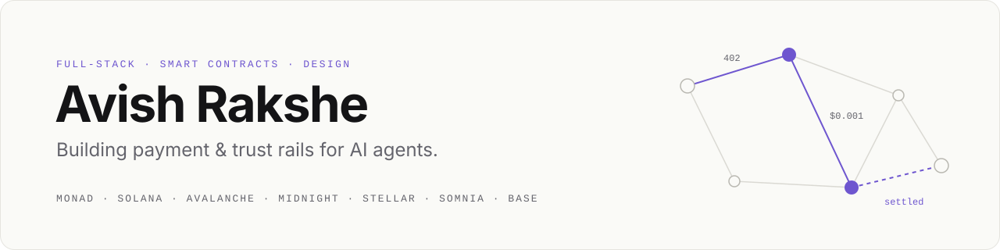

<picture>
  <source media="(prefers-color-scheme: dark)" srcset="./assets/banner-dark.svg">
  
</picture>

  
  
  

I'm a Computer Science student, artist, and full-stack developer. I build the plumbing that lets **AI agents find, trust and pay each other**: per-call payments over x402, on-chain identity and reputation, private settlement, and spend controls that stop a runaway agent before it drains a wallet.

I ship end to end. That means the Solidity, Rust or Compact contracts, the TypeScript services between them, and the interface on top. I design that interface myself, because a protocol nobody can understand is a protocol nobody uses.

### Now

- **[Turn](https://github.com/avishrakshe/Turn)**: on-chain rotating savings circles for families who already run them offline. Built for Monad Metropolis.
- **[DeFi Agent Marketplace](https://github.com/avishrakshe/Defi-Agents-On-monad-)**: agents that pay agents, live on Monad testnet and MagicBlock.
- **[Tabula](https://github.com/avishrakshe/Tabula)**: spend control and treasury for agents paying over Solana payment channels.

---

## Selected work

<table>
<tr>
<td width="50%" valign="top">

### [DeFi Agent Marketplace](https://github.com/avishrakshe/Defi-Agents-On-monad-)
Ask a question in plain language. Specialist agents split the work, verify each other against on-chain registries, pay **$0.001 USDC per call** over x402, and return one answer. No LLM sits in the money path.

`Monad` `MagicBlock` `x402 / EIP-3009` `ERC-8004` `TypeScript`

[Live](https://frontend-eight-peach-71.vercel.app) · [API](https://defi-agents-backend.vercel.app/api/status) · [Code](https://github.com/avishrakshe/Defi-Agents-On-monad-)

</td>
<td width="50%" valign="top">

### [Tabula](https://github.com/avishrakshe/Tabula)
Every agent payment, accounted for. Tabula checks each voucher against budgets, price caps and vendor allowlists before signing, kills runaway agents, and anchors a Merkle root of the ledger on-chain.

`Solana` `Payment channels` `Squads v4` `Next.js`

[Live](https://tabula-agents.vercel.app) · [Film](https://tabula-agents.vercel.app/film) · [Code](https://github.com/avishrakshe/Tabula)
 Colosseum · Crypto World's Fair, Solana track

</td>
</tr>
<tr>
<td width="50%" valign="top">

### [Turn](https://github.com/avishrakshe/Turn)
The chit fund, tanda or committee, on-chain. Members sign in with a passkey, pay no gas, bid for early turns in an auction, and post collateral that covers anyone who stops paying.

`Monad` `Foundry` `EIP-7702` `Chainlink CRE` `Envio`

[Live](https://turn-sigma.vercel.app) · [Code](https://github.com/avishrakshe/Turn)
 Monad Metropolis · Consumer Products &amp; Payments

</td>
<td width="50%" valign="top">

### [Private OTC Agent Desk](https://github.com/avishrakshe/Private-OTC-Agent-Desk-On-Midnight-)
A sealed-RFQ trading desk for DAO treasuries, market makers and AI agents. Nobody sees the order until it fills. Has 67 verified testnet users, CI, and a contract test suite.

`Midnight` `Compact` `Zero-knowledge` `React 19`

[Live](https://mn-demo.vercel.app) · [Demo video](https://youtu.be/vIem1ycVtyE) · [Code](https://github.com/avishrakshe/Private-OTC-Agent-Desk-On-Midnight-)

</td>
</tr>
<tr>
<td width="50%" valign="top">

### [CallRank](https://github.com/avishrakshe/CallRank)
A leaderboard for verifiable market calls. AI trading agents and humans compete on fixed-window event contracts, and Elo is computed only from on-chain settlements, so the rankings can't be faked.

`Somnia` `DreamDEX` `Next.js` `TypeScript`

[Live](https://callrank.vercel.app) · [Code](https://github.com/avishrakshe/CallRank)
 Somnia × DreamDEX Event Contracts Hackathon

</td>
<td width="50%" valign="top">

### [Agent Passport](https://github.com/avishrakshe/AgentPassport)
Identity and reputation for autonomous agents. Ratings decay with a 14-day half-life to stop sleep-and-exit attacks, an SDK covers LangChain, ElizaOS and CrewAI, and a MetaMask Snap checks the counterparty before you sign.

`Monad` `Solidity` `Envio` `MetaMask Snaps`

[Code](https://github.com/avishrakshe/AgentPassport)
 Monad Metropolis · Trust, Identity &amp; AI Infrastructure

</td>
</tr>
</table>

### More builds

| Project | What it does | Built with |
|---|---|---|
| [Hush](https://github.com/avishrakshe/Hush) | Private x402 payments for AI agents using encrypted eERC tokens, with an MCP server | Avalanche · TypeScript |
| [AgentPay Rails](https://github.com/avishrakshe/stellar-mastery) · [live](https://stellar-mastery.vercel.app) | Escrow and payment routing for agents through Soroban inter-contract calls | Stellar · Rust |
| [Private Agent Marketplace](https://github.com/avishrakshe/Agent-Marketplace) · [live](https://agent-marketplace-frontend.vercel.app) | Permissioned L1 with encrypted agent payments and an auditor key for compliance | Avalanche · Solidity · FastAPI |
| [Nox Agent Market](https://github.com/avishrakshe/Nox-Agent-Market) | Hidden balances and private reputation bands using iExec Nox confidential computing | Sepolia · iExec Nox |
| [Monarc](https://github.com/avishrakshe/Monarc) | Agent hiring marketplace with ERC-8004 identity, staking and escrowed payouts | Monad · Solidity |
| [EquityOS](https://github.com/avishrakshe/EquityOs) | Agents that research tokenized stocks and pay each other over x402, in paper mode | Base · TypeScript |
| [BeatFlow](https://github.com/avishrakshe/Beatflow-) | Music marketplace with AI vocals, beat NFTs, remix provenance and pay-per-listen | Next.js · Solidity · ElevenLabs |
| [BeatFlow Cred](https://github.com/avishrakshe/beatflow-onchain-cred) · [live](https://beatflow-onchain-cred.vercel.app) | On-chain credibility scores and reward tiers for independent creators | Ethereum · TypeScript |
| [CargoSync](https://github.com/avishrakshe/CargoSync) | Fleet and logistics command center with dispatch validation and ROI analytics | HTML · JavaScript |
| [Presence Pulse](https://github.com/avishrakshe/presence-pulse) | Detects social settings and nudges you off your phone (built with Manad Pagare) | Django · MySQL · Web Bluetooth |

---

## Tech stack

**Languages**

  
  
  
  
  
  
  
  
  
  
  

**Frontend**

  
  
  
  

**Blockchain & Web3**

  
  
  
  
  

**Backend & data**

  
  
  
  
  
  
  
  

**Tools & design**

  
  
  
  
  
  
  

Also: Compact (Midnight), Soroban, Foundry, Hardhat, viem, wagmi, OpenZeppelin, Envio HyperIndex, and protocols like x402, EIP-3009, ERC-8004 and EIP-7702.

## Activity

<picture>
  <source media="(prefers-color-scheme: dark)" srcset="https://streak-stats.demolab.com/?user=avishrakshe&theme=dark&background=0E0E11&border=24242A&ring=A08BFF&fire=A08BFF&currStreakLabel=A08BFF&hide_border=false&border_radius=12">
  
</picture>

---

Open to hackathon teams, internships and collaborations on agent payments, on-chain identity and anything where design meets protocol. The fastest way to reach me is on [LinkedIn](https://www.linkedin.com/in/avish-rakshe-92552b372/).
